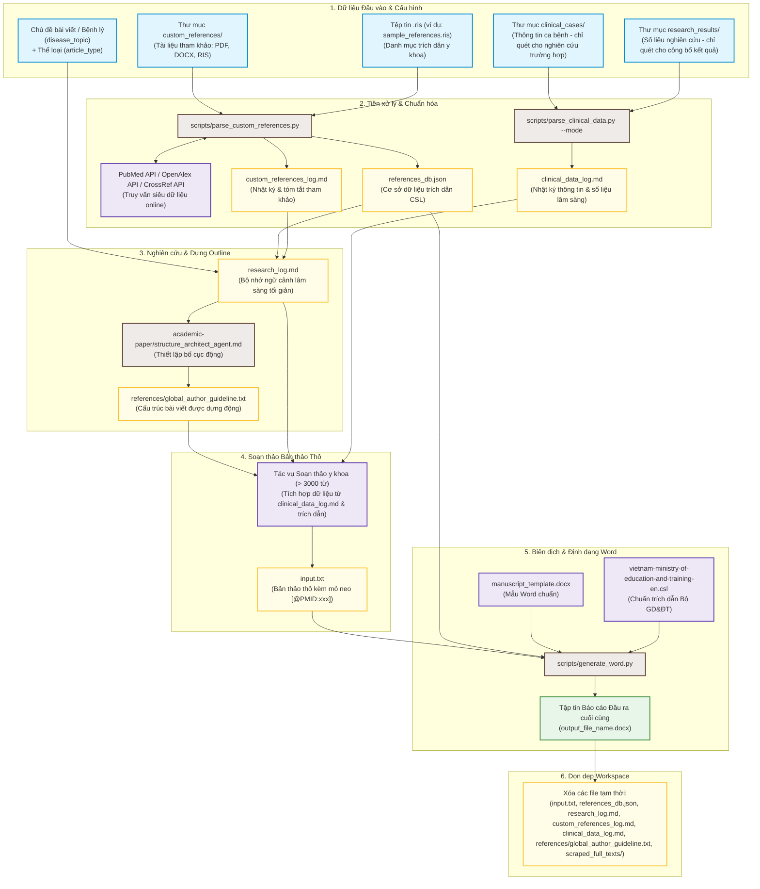

# MEDICAL MANUSCRIPT GENERATOR V2
## Pipeline & Tài liệu Kỹ thuật Hệ thống

Dự án **Medical Manuscript Generator v2** là một skill tự động hóa quy trình nghiên cứu y khoa lâm sàng chuyên sâu. Hệ thống tự động phân tích các tài liệu lâm sàng do người dùng cung cấp (.pdf, .docx, .ris hoặc danh mục trích dẫn y khoa), tự động thu thập và chuẩn hóa dữ liệu trích dẫn từ internet, sau đó biên soạn bản thảo y khoa học thuật chất lượng cao dưới dạng tệp Microsoft Word (.docx) chuẩn chỉnh.

Bản thảo đầu ra được tối ưu hóa cho các bài viết chuyên môn đăng tải trên website bệnh viện, tuân thủ các quy định nghiêm ngặt về bố cục nội dung của Bệnh viện Ung bướu và định dạng tài liệu tham khảo theo chuẩn của Bộ Giáo dục & Đào tạo Việt Nam.

---

## 1. Sơ đồ Pipeline (Quy trình Hoạt động)

Dưới đây là sơ đồ mô tả toàn bộ luồng xử lý dữ liệu từ đầu vào đến tài liệu đầu ra cuối cùng:



---

## 2. Chi tiết các Bước trong Pipeline

### Bước 1: Quét tài liệu tùy chọn và Xây dựng Cơ sở dữ liệu trích dẫn
*   **Script thực hiện:** [parse_custom_references.py](file:///d:/OneDrive/skills/medical-manuscript-generator-v2.1/scripts/parse_custom_references.py)
*   **Thư mục đầu vào:** [custom_references/](file:///d:/OneDrive/skills/medical-manuscript-generator-v2.1/custom_references)
*   **Cách thức hoạt động:**
    1.  **Quét tệp tin:** Quét toàn bộ thư mục để tìm các tài liệu tùy chọn dạng `.pdf`, `.docx`, hoặc tệp tin danh mục trích dẫn `.ris` trong thư mục [custom_references/](file:///d:/OneDrive/skills/medical-manuscript-generator-v2.1/custom_references).
    2.  **Trích xuất định danh:** Đọc 500 ký tự đầu tiên của mỗi tài liệu để phát hiện mã số DOI hoặc PMID của chính tài liệu đó.
    3.  **Tải siêu dữ liệu & Toàn văn (Full-Text Retrieval):** 
        *   Nếu có DOI/PMID: Gửi yêu cầu đến các API PubMed, OpenAlex, và CrossRef để lấy thông tin thư mục chuẩn hóa.
        *   **Tải toàn văn:** Tự động truy cập **PMC (PubMed Central) API** và **Unpaywall API** để tải về tệp văn bản toàn văn của bài báo Open Access (nếu có), lưu tại thư mục tạm `custom_references/scraped_full_texts/{citation_key}.txt` phục vụ cho việc đọc hiểu chi tiết của Agent.
        *   Nếu không có DOI/PMID (tài liệu nội bộ) hoặc là file PDF/DOCX cục bộ: Trích xuất nội dung văn bản thô cục bộ và lưu trữ tại `custom_references/scraped_full_texts/` để AI Agent tham khảo theo cơ chế thống nhất.
    4.  **Cào tài liệu con (References of References):** Dò tìm toàn bộ DOI/PMID xuất hiện trong nội dung tài liệu gốc, tự động cào thông tin metadata và tải toàn văn của chúng (tối đa 30 tài liệu con) từ internet về.
    5.  **Kết quả đầu ra:** 
        *   Tạo cơ sở dữ liệu CSL JSON tại `references_db.json`.
        *   Tạo báo cáo ngữ cảnh `custom_references_log.md` liệt kê danh sách tài liệu, liên kết đến tập tin toàn văn `.txt` tương ứng và các khóa trích dẫn dạng `[@PMID:38382875]` hoặc `[@PMID:custom_...]`.

### Bước 1.2: Quét thông tin bệnh nhân và số liệu nghiên cứu của người dùng
*   **Script thực hiện:** [parse_clinical_data.py](file:///d:/OneDrive/skills/medical-manuscript-generator-v2.1/scripts/parse_clinical_data.py)
*   **Thư mục đầu vào:** [clinical_cases/](file:///d:/OneDrive/skills/medical-manuscript-generator-v2.1/clinical_cases) (quét trong chế độ `cases`) và [research_results/](file:///d:/OneDrive/skills/medical-manuscript-generator-v2.1/research_results) (quét trong chế độ `results`)
*   **Cách thức hoạt động:**
    1.  **Quét tệp tin chọn lọc:**
        *   *Bài báo tổng quan*: Bỏ qua không quét dữ liệu lâm sàng/nghiên cứu.
        *   *Bài báo nghiên cứu trường hợp*: Chạy script với tham số `--mode cases` để quét thư mục `clinical_cases/`.
        *   *Bài báo công bố kết quả nghiên cứu*: Chạy script với tham số `--mode results` để quét thư mục `research_results/`.
    2.  **Kết quả đầu ra:** Tổng hợp nội dung các tệp này và kết xuất thành tệp nhật ký `clinical_data_log.md` tại thư mục gốc của workspace làm nguồn dữ liệu thực tế cho AI viết bài.

### Bước 2: Xây dựng Bộ nhớ Nghiên cứu Lâm sàng & Cấu trúc bài viết (Outline) động
*   **Tập tin tạo ra:** `research_log.md` và `references/global_author_guideline.txt`
*   **Cách thức hoạt động:**
    1.  **Xây dựng bộ nhớ:** AI phân tích danh sách tài liệu đã được chuẩn hóa, lựa chọn các tài liệu phù hợp nhất với chủ đề cần viết (`disease_topic`) và ghi chú ngắn gọn vào `research_log.md`.
    2.  **Dựng cấu trúc động:** Dựa trên thể loại bài viết tự động nhận diện từ câu lệnh đầu vào của người dùng, AI chạy agent [structure_architect_agent.md](file:///d:/OneDrive/skills/medical-manuscript-generator-v2.1/academic-paper/structure_architect_agent.md) để xây dựng bố cục phù hợp nhất:
        *   *Bài báo tổng quan*: Áp dụng **Pattern 2 (Thematic Literature Review)**.
        *   *Bài báo nghiên cứu trường hợp*: Áp dụng **Pattern 4 (Case Study)**.
        *   *Bài báo công bố kết quả nghiên cứu*: Áp dụng **Pattern 1 (IMRaD)**.
        Bố cục chi tiết này sẽ được lưu trữ trực tiếp vào tệp `references/global_author_guideline.txt` làm chỉ dẫn viết bài.

### Bước 3: Soạn thảo Bản thảo học thuật chuyên sâu
*   **Tập tin tạo ra:** `input.txt` (nằm ở thư mục gốc workspace)
*   **Cách thức hoạt động:**
    1.  AI đọc nội dung từ nhật ký tài liệu, tích hợp sâu sắc các số liệu lâm sàng thực tế, phác đồ điều trị và các hướng dẫn chuyên môn vào bài viết. Đối với bài báo nghiên cứu trường hợp hoặc công bố kết quả nghiên cứu, AI Agent sẽ chắt lọc trực tiếp dữ liệu thô lâm sàng/nghiên cứu thực tế từ `clinical_data_log.md`.
    2.  Biên soạn bài viết bằng tiếng Việt chuyên ngành y khoa với độ dài **> 3000 từ**.
    3.  Tuân thủ nghiêm ngặt khung cấu trúc chương lớn được định nghĩa động tại `references/global_author_guideline.txt` vừa dựng ở Bước 2.
    4.  Chèn các mỏ neo trích dẫn dạng `[@PMID:xxxx]` (đã được định nghĩa ở Bước 1) ngay sau các nhận định, số liệu tương ứng.
    5.  **Định dạng thô:** Lưu nội dung thô vào `input.txt`. Dòng đầu tiên là tiêu đề bài viết. Không sử dụng ký tự in đậm Markdown (`**...**`) làm heading hoặc tiền tố kiểu dáng để tránh xung đột định dạng Word.

### Bước 4: Biên dịch và Định dạng Word
*   **Script thực hiện:** [generate_word.py](file:///d:/OneDrive/skills/medical-manuscript-generator-v2.1/scripts/generate_word.py)
*   **Tập tin đầu ra:** `[output_file_name].docx`
*   **Cách thức hoạt động:**
    1.  **Đọc cấu trúc & Styles:** Đọc file mẫu [manuscript_template.docx](file:///d:/OneDrive/skills/medical-manuscript-generator-v2.1/references/manuscript_template.docx) để lấy các kiểu mẫu có sẵn như `tiêu đề`, `Heading 1`, `Heading 2`, `Heading 3`, và `Normal`.
    2.  **Thay thế mỏ neo trích dẫn:** Quét toàn bộ văn bản, ánh xạ các neo `[@PMID:xxxx]` thành số trích dẫn tăng dần `[1]`, `[2]`, `[3]`... theo đúng thứ tự xuất hiện lần đầu trong văn bản.
    3.  **Áp dụng định dạng chuẩn:**
        *   Phông chữ: **Times New Roman**.
        *   Cỡ chữ: **14** cho đoạn nội dung bình thường.
        *   Giãn dòng: **1.25**.
        *   Căn lề: Căn đều hai bên (**Justify**).
    4.  **Tạo Danh mục Tài liệu Tham khảo:** Sử dụng thư viện `citeproc-py` kết hợp với file định dạng chuẩn của Bộ GD&ĐT [vietnam-ministry-of-education-and-training-en.csl](file:///d:/OneDrive/skills/medical-manuscript-generator-v2.1/references/vietnam-ministry-of-education-and-training-en.csl) để tự động sắp xếp và xuất bản danh sách tài liệu tham khảo ở cuối file Word. Tên tác giả y khoa sẽ được tự động in đậm.

### Bước 5: Kiểm tra Chất lượng (QA) và Dọn dẹp Workspace
*   **Cách thức hoạt động:**
    1.  AI rà soát lại file Word (.docx) được tạo ra để đảm bảo không còn sót lại các ký tự neo trích dẫn thô chưa được xử lý, kiểm tra độ chính xác của tiêu đề và định dạng.
    2.  **Tự động dọn dẹp:** Sau khi xuất file thành công, hệ thống bắt buộc phải tự động xóa các file tạm gồm: `input.txt`, `references_db.json`, `research_log.md`, `custom_references_log.md`, `clinical_data_log.md`, `references/global_author_guideline.txt`, và cả thư mục tạm `custom_references/scraped_full_texts/` để giải phóng workspace, đảm bảo bảo mật thông tin và tránh lưu trữ rác.

---

## 3. Cấu trúc Thư mục Dự án

```text
medical-manuscript-generator-v2/
├── SKILL.md                          # Hướng dẫn định nghĩa skill cho AI Agent
├── README.md                         # Tài liệu giới thiệu & Pipeline này
├── requirements.txt                  # Các thư viện Python phụ thuộc
│
├── custom_references/                # Nơi người dùng đặt tài liệu y khoa tự chọn
│   ├── README.txt                    # Hướng dẫn sử dụng thư mục tài liệu tự chọn
│   └── sample_references.ris         # Tệp danh mục trích dẫn mẫu (.ris)
│
├── clinical_cases/                   # Nơi đặt tệp thông tin ca bệnh lâm sàng (.pdf, .docx, .txt...)
│   └── README.txt                    # Hướng dẫn cung cấp thông tin ca lâm sàng
│
├── research_results/                 # Nơi đặt tệp số liệu và kết quả nghiên cứu khoa học
│   └── README.txt                    # Hướng dẫn cung cấp số liệu nghiên cứu
│
├── references/                       # Các tài nguyên mẫu & hướng dẫn định dạng
│   ├── global_author_guideline.txt   # Cấu trúc bài viết được dựng động (Tệp tạm, tự động sinh và xóa)
│   ├── manuscript_template.docx      # Bản mẫu Microsoft Word (chứa sẵn Styles)
│   └── vietnam-ministry-of-education-and-training-en.csl # Định dạng trích dẫn chuẩn Bộ GD&ĐT
│
└── scripts/                          # Mã nguồn Python thực thi các bước pipeline
    ├── parse_custom_references.py    # Quét tài liệu tùy chọn, cào metadata & tạo DB CSL
    ├── parse_clinical_data.py        # Quét thông tin bệnh nhân & số liệu của người dùng
    └── generate_word.py              # Xử lý văn bản thô, ánh xạ trích dẫn & kết xuất file .docx
```

---

## 4. Hướng dẫn Thiết lập & Sử dụng

### 4.1. Môi trường yêu cầu
*   **Python:** Phiên bản 3.8 trở lên.
*   **Các thư viện chính:** Được liệt kê đầy đủ tại [requirements.txt](file:///d:/OneDrive/skills/medical-manuscript-generator-v2/requirements.txt).

### 4.2. Cài đặt các thư viện phụ thuộc
Mở terminal tại thư mục dự án và chạy lệnh:
```bash
pip install -r requirements.txt
```

### 4.3. Chạy Pipeline bằng lệnh thủ công (Manual Execution)

Nếu muốn thử nghiệm chạy độc lập từng bước bên ngoài AI Agent:

1.  **Bước 1: Quét tài liệu tùy chọn và cào siêu dữ liệu**
    Đặt các file tài liệu y khoa PDF/DOCX hoặc tệp tin `.ris` vào thư mục `custom_references/`. Sau đó chạy:
    ```bash
    python scripts/parse_custom_references.py --folder custom_references --output-db references_db.json
    ```
    *Lệnh này sẽ tạo ra tệp `references_db.json` chứa dữ liệu trích dẫn chuẩn và file `custom_references_log.md` để theo dõi các khóa.*

2.  **Bước 2: Viết bản thảo thô**
    Tự tạo tệp `input.txt` trong thư mục gốc, viết bài viết bằng tiếng Việt và chèn các mỏ neo trích dẫn. Ví dụ:
    ```text
    Liệu pháp miễn dịch trong điều trị ung thư đường mật tiến triển
    I. MỞ ĐẦU
    1. Định nghĩa: Ung thư đường mật (Cholangiocarcinoma - CCA) là... [@PMID:38382875]
    2. Dịch tễ học: Bệnh lý này chiếm khoảng...
    ```

3.  **Bước 3: Biên dịch sang Word (.docx)**
    Tiến hành biên dịch từ file văn bản thô sang định dạng Word chuẩn:
    ```bash
    python scripts/generate_word.py input.txt output_ban_thao.docx
    ```
    *Tệp `output_ban_thao.docx` được tạo ra sẽ có đầy đủ định dạng chữ Times New Roman cỡ 14, giãn dòng 1.25, justify, các tiêu đề được gán style và phần mục lục Tài liệu tham khảo chuẩn ở cuối.*

---

## 5. Quy tắc Vận hành bắt buộc (Focus Mode)

*   **Focus Mode lâm sàng:** Hệ thống bỏ qua các cơ chế tìm kiếm rộng trên Internet và API PubMed mở rộng, chỉ tập trung đọc và trích dẫn trực tiếp các tài liệu người dùng đã chỉ định trong thư mục `custom_references`. Điều này đảm bảo nội dung y khoa bám sát thực tế nghiên cứu lâm sàng của chuyên gia, loại bỏ thông tin nhiễu.
*   **Quản lý bộ nhớ tạm:** File `research_log.md` bắt buộc phải là ghi chú siêu ngắn gọn để tối ưu hóa lượng token truyền tải cho AI.
*   **Nguyên tắc dọn dẹp sạch sẽ:** Không để lại các tệp tin tạm (`input.txt`, `references_db.json`, `research_log.md`, `custom_references_log.md`, `clinical_data_log.md`) trong workspace sau khi đã biên dịch thành công file `.docx`.
